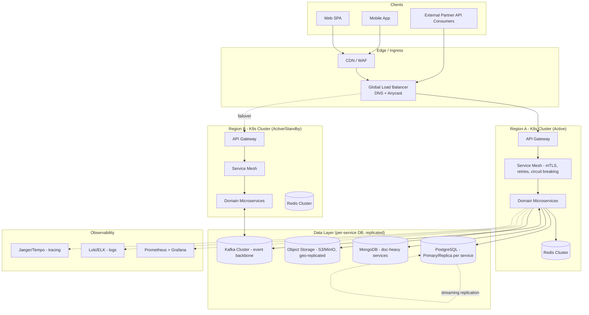

# ERP System — High-Availability Microservices Architecture

> Status: Draft v1.0
> Owner: TBD
> Scope: Reference architecture for a production-grade, horizontally scalable, multi-region-capable ERP platform.

This document is the foundation. Every subsequent service will be built against the contracts, patterns, and constraints defined here — do not start coding services before this is reviewed and agreed.

---

## 1. Goals & Non-Functional Requirements

| Requirement | Target |
|---|---|
| Availability | 99.95% (≈4.4h downtime/year) per core service, 99.99% for API Gateway/Auth |
| RPO (data loss tolerance) | < 1 minute (async replication), 0 for financial ledger (sync replication) |
| RTO (recovery time) | < 5 minutes for AZ failure, < 30 minutes for region failure |
| Latency | p95 < 300ms for read APIs, p95 < 800ms for write/transactional APIs |
| Scale | Horizontally scalable per-service; no single service is a scale bottleneck |
| Consistency | Strong consistency within a service's own data; eventual consistency across services via events |
| Multi-tenancy | Single deployment must support multiple tenants (companies/orgs) with data isolation |
| Auditability | Every financial/inventory-affecting mutation is immutable-logged (event sourced or append-only audit table) |
| Compliance | Data encrypted at rest & in transit; role-based + attribute-based access control |

**Why microservices, explicitly:** an ERP touches Finance, Inventory, HR, Sales, Procurement, Manufacturing — domains with different scaling needs, different release cadences, and different teams. A monolith would force one deployment cadence and one failure blast-radius for all of them. The cost we accept in exchange is operational complexity (service mesh, distributed tracing, saga orchestration) — this doc exists to manage that cost deliberately, not accidentally.

---

## 2. Domain Decomposition (Bounded Contexts)

Each box below is an independently deployable service, with its own database, its own team ownership, and its own CI/CD pipeline. Decomposition follows Domain-Driven Design bounded contexts, not technical layers — never split a service by "controller/service/repo", split by business capability.

| Domain | Service | Owns Data For |
|---|---|---|
| **Identity & Access** | `identity-service` | Users, roles, permissions, tenants, OAuth2/OIDC tokens |
| **Master Data** | `master-data-service` | Customers, vendors, items/SKUs, chart of accounts, price lists |
| **Sales** | `sales-service` | Sales orders, quotations, customer contracts |
| **Procurement** | `procurement-service` | Purchase orders, RFQs, vendor contracts |
| **Inventory** | `inventory-service` | Stock levels, warehouses, bins, stock movements, reservations |
| **Manufacturing** | `manufacturing-service` | BOMs, work orders, production schedules |
| **Warehouse/Logistics** | `logistics-service` | Shipments, pick/pack, carriers, delivery tracking |
| **Finance/Accounting** | `finance-service` | General ledger, journal entries, AP/AR, tax |
| **Payroll/HR** | `hr-service` | Employees, payroll runs, leave, attendance |
| **CRM** | `crm-service` | Leads, opportunities, support tickets |
| **Reporting/BI** | `reporting-service` | Read-only aggregated projections (CQRS read models) |
| **Notification** | `notification-service` | Email/SMS/push dispatch, templates |
| **Document/File** | `document-service` | Attachments, generated PDFs (invoices, POs), object storage refs |
| **Audit** | `audit-service` | Immutable event log across all domains (compliance) |

Cross-cutting **platform** services (not business domains, but required for every domain service to run):

- `api-gateway` — single entry point, routing, auth enforcement, rate limiting
- `config-service` — centralized configuration (Spring Cloud Config / Consul KV / etcd)
- `service-registry` — service discovery (if not using k8s DNS + mesh natively)
- `identity-service` (above, doubles as platform auth issuer)

---

## 3. High-Level Architecture Diagram

**Key HA decisions embedded in this diagram:**
- Active-active or active-passive across two (minimum) availability zones per region, and two regions for DR.
- Kafka is the event backbone shared across regions (via MirrorMaker 2 for cross-region replication) — it decouples services so a downstream outage doesn't cascade.
- Every service owns its database (polyglot persistence allowed, but justify each non-default choice).
- Nothing reaches a database directly except the service that owns it — no shared schemas, ever.

---

## 4. Communication Patterns

### 4.1 Synchronous (request/response)
- **External:** REST/JSON via API Gateway (GraphQL federation optional for BFF layer if the frontend team wants it).
- **Internal, service-to-service:** gRPC for low-latency internal calls where a synchronous answer is unavoidable (e.g., inventory availability check during checkout).
- All synchronous calls **must** have: timeout, retry with jittered backoff, and circuit breaker (Resilience4j / Envoy-native via mesh).

### 4.2 Asynchronous (event-driven) — the default
- **Kafka** as the backbone. Services publish domain events (`OrderPlaced`, `StockReserved`, `InvoiceIssued`, `PaymentReceived`) to topics they own.
- Other services subscribe and build their own local read models — this is what keeps services independently deployable and avoids the "distributed monolith" trap of everything calling everything synchronously.
- **Outbox pattern** mandatory: a service writes its DB change and the outgoing event in the same local transaction (outbox table), and a CDC connector (Debezium) publishes to Kafka. This guarantees no event is lost or published without the corresponding state change actually committing.

### 4.3 Distributed transactions — Saga pattern
ERPs have inherently cross-domain transactions (e.g., "place order" touches Sales, Inventory, Finance). Two-phase commit across services is not acceptable at this scale. Use **choreographed sagas** for simple 2-3 step flows, and **orchestrated sagas** (a dedicated `saga-orchestrator` using Temporal.io or Camunda) for complex multi-step business processes like order-to-cash or procure-to-pay, where you need visibility, retries, and compensating actions to be explicit and testable.

Example — Order-to-Cash saga:
1. `sales-service` creates order (status: PENDING) → emits `OrderPlaced`
2. `inventory-service` reserves stock → emits `StockReserved` (or `StockReservationFailed` → compensating: cancel order)
3. `finance-service` creates AR entry → emits `InvoiceIssued`
4. `logistics-service` schedules shipment
5. `sales-service` marks order CONFIRMED on all successes, or triggers compensations on any failure

---

## 5. Data Management Strategy

- **Database-per-service** — no exceptions. Cross-service joins are done in the `reporting-service` via CQRS read models built from consumed events, never via direct DB access.
- **CQRS** for reporting/BI: write models stay normalized and fast; `reporting-service` maintains denormalized, query-optimized projections (could be Elasticsearch or a columnar store like ClickHouse) fed by Kafka.
- **Event sourcing** for `finance-service` specifically (ledger must be append-only and reconstructable — this is a compliance requirement, not just a technical preference).
- **Sharding**: `inventory-service` and `finance-service` shard by `tenant_id` once a single tenant's data volume justifies it; start with schema-per-tenant, graduate to database-per-large-tenant.

---

## 6. High-Availability Mechanics (per layer)

| Layer | HA Mechanism |
|---|---|
| DNS/Edge | Multi-region Anycast + health-checked failover (Route53/Cloudflare) |
| API Gateway | Min 3 replicas, HPA, spread across AZs via pod anti-affinity |
| Service mesh | Istio/Linkerd — automatic retries, outlier detection (ejects unhealthy pods), mTLS |
| Compute | Kubernetes, min 3 replicas per service, PodDisruptionBudget, multi-AZ node pools |
| Database | Primary + 2 async replicas minimum; synchronous replica for `finance-service` ledger; automated failover (Patroni for Postgres) |
| Cache | Redis Cluster mode, 3 masters + 3 replicas minimum |
| Messaging | Kafka, replication factor ≥ 3, min.insync.replicas=2, rack-awareness across AZs |
| Object storage | S3 (or MinIO) with cross-region replication for documents/attachments |
| Secrets | HashiCorp Vault, HA mode (Raft storage backend, 3+ nodes) |

**Resilience patterns required in every service:**
- Circuit breaker on every outbound call (mesh-enforced default, service-level override where needed)
- Bulkhead isolation — separate thread/connection pools per downstream dependency so one slow dependency can't starve the whole service
- Idempotency keys on all write endpoints (critical for saga retries not double-charging/double-shipping)
- Graceful degradation — e.g., if `reporting-service` is down, order placement must still work; if `notification-service` is down, it must not block order confirmation

---

## 7. Security

- **AuthN:** OIDC via `identity-service` (Keycloak-based or custom), JWT access tokens (short-lived, ~15 min) + refresh tokens.
- **AuthZ:** RBAC baseline + ABAC for tenant/entity-level rules (e.g., "approver can only approve POs under $10k for their department").
- **Service-to-service:** mTLS enforced by the service mesh — no service accepts plaintext internal traffic.
- **Secrets:** Vault-issued, dynamically rotated DB credentials — no static passwords in config/env.
- **Data at rest:** encrypted (DB-native TDE + encrypted volumes).
- **Tenant isolation:** enforced at the DB row level (RLS in Postgres) in addition to application-level checks — defense in depth.
- **Audit trail:** every mutating request logged to `audit-service` with actor, tenant, before/after diff — required for financial compliance (SOX-style controls).

---

## 8. Observability

- **Metrics:** Prometheus scraping every service (RED metrics: Rate, Errors, Duration) + Grafana dashboards + Alertmanager.
- **Logs:** structured JSON logs shipped to Loki or ELK, correlated by `trace_id`.
- **Tracing:** OpenTelemetry SDK in every service → Jaeger or Tempo, so a single order-placement request can be traced across Sales → Inventory → Finance.
- **SLOs** defined per service (see NFR table) with error-budget-based alerting, not just static thresholds.

---

## 9. Deployment & Infrastructure

- **Kubernetes** (EKS/GKE/AKS or self-managed) as the runtime, one cluster per region minimum.
- **GitOps** via ArgoCD/Flux — cluster state is declarative and reviewed via PR, no manual `kubectl apply` to production.
- **CI/CD** per service: independent pipeline, independent versioning/tagging, canary or blue-green rollout via the mesh (Argo Rollouts).
- **Infrastructure as Code:** Terraform for all cloud resources (clusters, DBs, networking) — no console click-ops.
- **Environments:** dev → staging → prod, with staging mirroring prod topology (smaller scale) to catch HA/failover issues before release.

---

## 10. Suggested Tech Stack (opinionated defaults — swap per team expertise)

| Concern | Choice |
|---|---|
| Service language | Java/Spring Boot or Go (pick one as default; polyglot only with justification) |
| API Gateway | Kong / Apache APISIX / Spring Cloud Gateway |
| Service mesh | Istio (or Linkerd for lower ops overhead) |
| Messaging | Apache Kafka + Debezium (CDC/outbox) |
| Primary DB | PostgreSQL (per-service instances) |
| Document DB | MongoDB (only for services with genuinely schema-flexible data, e.g. `document-service` metadata) |
| Cache | Redis Cluster |
| Search/Reporting | Elasticsearch or ClickHouse |
| Orchestration | Kubernetes + ArgoCD |
| Saga orchestration | Temporal.io |
| Secrets | HashiCorp Vault |
| Observability | Prometheus + Grafana + Loki + Jaeger (or full OpenTelemetry Collector pipeline) |

---

## 11. Delivery Roadmap (phased, not big-bang)

1. **Phase 0 — Platform foundation:** k8s clusters, service mesh, API gateway, Vault, CI/CD templates, observability stack, `identity-service`.
2. **Phase 1 — Core financial spine:** `master-data-service`, `finance-service` (ledger), `audit-service` — get the system of record right first, everything else hangs off it.
3. **Phase 2 — Operational core:** `inventory-service`, `procurement-service`, `sales-service` with the Order-to-Cash and Procure-to-Pay sagas.
4. **Phase 3 — Extended domains:** `manufacturing-service`, `logistics-service`, `hr-service`, `crm-service`.
5. **Phase 4 — Insight layer:** `reporting-service` (CQRS projections), BI dashboards.
6. **Phase 5 — Multi-region DR:** promote the second region from cold/warm standby to fully active-active, run failover game days.

Each phase ends with a load test and a chaos-engineering exercise (kill a pod/AZ/DB primary) before moving to the next — HA claims in section 1 are not real until they've been tested under actual failure.

---

## Next Documents Needed

- `docs/service-contracts/` — OpenAPI/proto specs per service, defined before implementation starts
- `docs/event-catalog.md` — every Kafka topic, event schema (Avro/Protobuf + schema registry), producer/consumer map
- `docs/data-model/<service>.md` — ERD per service
- `docs/adr/` — Architecture Decision Records for every non-default choice made above
